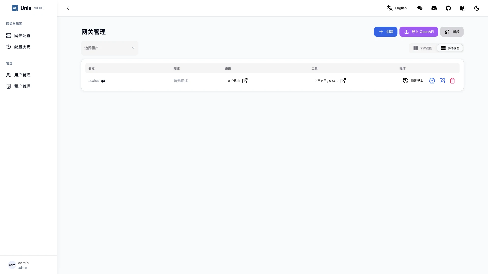

# 在 Sealos 上部署和托管 Unla

Unla 是一款自托管 MCP 网关，通过 Web 控制台将 REST API 和现有 MCP 服务转换为可管理的 MCP 端点。本模板将 Unla all-in-one 镜像 v0.10.0 部署为单个 StatefulSet，使用 SQLite 存储并创建超级管理员。

## 关于托管 Unla

Unla 以单个 all-in-one 服务运行，监听 `80` 端口。服务包含 API Server、MCP 网关、管理控制台，以及位于 `/app/data/unla.db` 的 SQLite 数据库。模板将 1Gi 卷挂载到 `/app/data`，网关配置、MCP 定义和管理员数据在重启后保留。

Model Context Protocol（MCP）为 AI 客户端提供发现和调用工具的标准方式。Unla 位于这些客户端与现有 HTTP API 之间：在控制台描述 API 后，Unla 发布 MCP 端点，MCP 客户端可以列出并调用暴露的工具。

Sealos 负责创建 StatefulSet、持久卷、ClusterIP Service、Ingress、TLS 证书和应用卡片。超级管理员用户名和密码来自部署输入，生成的 JWT 密钥用于签名控制台会话。

## 常见使用场景

- **REST API 转 MCP**：将现有 HTTP API 发布为 MCP 工具，供 AI Agent 和桌面客户端使用。
- **MCP 聚合**：在一个控制台中管理多个 MCP 服务，并保持一致的端点模型。
- **工具治理**：集中管理面向 Agent 的工具认证、配置和可见性。
- **内部 AI 助手**：将公司 API 连接到助手，无需为每个集成单独重写。
- **Agent 工作流原型**：在进入生产前创建和测试 MCP 配置。

## Unla 托管依赖

- 一个 Sealos 工作空间，至少提供 1Gi 可用内存和 1Gi 持久存储。
- 用于 Unla 管理控制台的浏览器。
- Pod 到所有注册的上游 API 或 MCP 服务的网络访问。
- 用于测试已发布端点的 MCP 客户端。

### 部署依赖

- [Unla 官网](https://unla.amoylab.com) - 产品介绍
- [Unla 文档](https://docs.unla.amoylab.com) - 安装、网关和 MCP 配置指南
- [Unla GitHub 仓库](https://github.com/amoylab/unla) - 源码和版本发布
- [Unla 容器镜像](https://github.com/amoylab/unla/pkgs/container/unla) - 本模板使用的镜像
- [Model Context Protocol](https://modelcontextprotocol.io) - MCP 规范和客户端生态
- [Sealos 文档](https://sealos.io/docs) - 平台概念和操作说明

## 实现细节

**架构组件：**

- **Unla StatefulSet**：一个副本，运行 `ghcr.io/amoylab/unla/allinone:v0.10.0`，监听 `80` 端口。
- **数据卷**：1Gi，挂载到 `/app/data`，保存 SQLite 数据库和网关状态。
- **Service**：ClusterIP 端口 `80`，转发到 Unla 的 HTTP 端口。
- **Ingress**：Sealos 托管的 HTTPS 域名，请求体上限 32Mi，代理超时 300 秒。
- **应用入口**：打开 Unla 管理控制台。

**配置：**

- **镜像**：`ghcr.io/amoylab/unla/allinone:v0.10.0`
- **HTTP 端口**：`80`
- **运行环境**：`ENV=production`
- **API 数据库**：SQLite，位于 `/app/data/unla.db`
- **网关存储**：数据库模式，SQLite 位于 `/app/data/unla.db`
- **JWT 密钥**：生成的 `jwt_secret`，写入 `APISERVER_JWT_SECRET_KEY`
- **超级管理员用户名**：必填输入 `admin_username`，默认 `admin`
- **超级管理员密码**：必填输入 `admin_password`
- **公网地址**：`https://${{ defaults.app_host }}.${{ SEALOS_CLOUD_DOMAIN }}/`
- **健康检查**：`GET /`
- **运行安全**：启用 `RuntimeDefault` seccomp 配置，关闭服务账号令牌自动挂载
- **时区**：`Asia/Shanghai`

**资源分配：**

| 组件 | CPU 请求 | CPU 限制 | 内存请求 | 内存限制 | 存储 |
| --- | ---: | ---: | ---: | ---: | ---: |
| Unla | 100m | 1 | 102Mi | 1024Mi | 1Gi |

Sealos 实测使用超级管理员登录，创建 `sealos-qa` MCP 配置，并在 Pod 重启后恢复配置和账号。Pod 使用该配置保持就绪，实测数值已写入工作负载注解。

## 为什么在 Sealos 上部署 Unla？

Sealos 是构建在 Kubernetes 上的 AI 辅助云操作系统，通过统一界面提供 Unla 所需的计算、存储、网络和运维能力：

- **一键部署**：用一个模板创建 StatefulSet、数据卷、Service、Ingress 和应用卡片。
- **网关状态持久化**：将 MCP 配置和管理员数据保存在独立持久卷中。
- **托管 HTTPS**：为控制台和已发布端点提供公网域名和 TLS 证书。
- **集中控制台**：在一个位置管理 REST 到 MCP 的映射和 MCP 服务定义。
- **资源可控**：网关流量增长时，通过资源卡片调整 CPU 和内存。
- **运维可见**：在 Canvas 或 Sealos AI 对话框中查看 Pod、日志、事件和资源使用情况。

## 部署指南

1. 打开 [Unla 模板](https://sealos.io/products/app-store/unla)，点击 **Deploy Now**。
2. 设置超级管理员用户名和密码并保存密码，确认自动生成的应用名称。
3. 提交部署，等待 2-3 分钟，Pod 进入就绪状态并完成 HTTPS 证书签发。
4. 打开应用卡片，登录 Unla 控制台。
5. 为测试 REST API 创建 MCP 配置，填写上游 URL 和认证信息。
6. 发布配置，并将生成的 MCP 端点复制到 MCP 客户端。
7. 从客户端列出可用工具并调用其中一个，确认网关链路正常。

## 登录与访问

公网地址打开 Unla 控制台。使用部署输入中的超级管理员用户名和密码登录。账号在首次启动时创建，后续可以在控制台中修改密码。

JWT 密钥用于签名控制台会话。修改 `APISERVER_JWT_SECRET_KEY` 会使现有会话失效，需要重新登录。跨版本更新时保持密钥稳定，浏览器会话和集成即可继续使用。

## 使用 Unla

控制台围绕 MCP 配置组织工作。配置定义上游 API 或 MCP 服务、需要暴露的工具，以及调用上游时使用的认证方式。发布后，控制台会显示客户端应使用的 MCP 端点。

MCP 客户端连接该端点，列出可用工具，并使用 JSON 参数调用。Unla 将每次调用转换为配置的上游请求，并把响应返回客户端。构建配置时，可以通过控制台日志和请求历史核对映射关系。

## 扩缩容

all-in-one 镜像使用单个 SQLite 数据库和 ReadWriteOnce 卷，因此 Unla 运行一个副本。已发布工具较多、请求负载较大或网关并发提高时，通过提高 CPU 和内存限制纵向扩容。

1Gi 卷保存网关配置、管理员数据和 SQLite 状态。数据库或日志增长后可以扩展 PVC，前提是存储类支持扩容。水平扩容需要拆分 API Server 和网关，并配置外部数据库，本 all-in-one 模板未配置这些组件。

## 故障排查

### 管理员登录被拒绝

- 原因：控制台仍使用更早部署的凭据，或者环境变量修改后 Pod 尚未重启。
- 处理：核对 `SUPER_ADMIN_USERNAME` 和 `SUPER_ADMIN_PASSWORD` 与保存值，更新后重启 StatefulSet。

### 重新部署后现有会话失效

- 原因：新的 `APISERVER_JWT_SECRET_KEY` 会使旧密钥签名的令牌失效。
- 处理：更新时保持相同密钥，修改后重新登录。

### 已发布工具无法访问上游 API

- 原因：Pod 无法访问上游主机、URL 错误，或者上游凭据无效。
- 处理：在命名空间内的 Pod 中测试上游 URL，确认集群出站访问，并检查 MCP 配置中的认证字段。

### MCP 客户端收到空工具列表

- 原因：配置尚未发布、端点路径错误，或者客户端未发送预期认证。
- 处理：发布配置，从控制台复制端点，并将客户端请求与控制台请求日志进行对比。

### 部署后控制台返回 502

- 原因：Unla 仍在启动，或者就绪探针尚未通过。
- 处理：等待启动探针完成，然后检查 Pod 事件和日志中的数据库或迁移错误。

### 获取帮助

- [Unla 文档](https://docs.unla.amoylab.com)
- [Unla GitHub Issues](https://github.com/amoylab/unla/issues)
- [Model Context Protocol](https://modelcontextprotocol.io)
- [Sealos 文档](https://sealos.io/docs)

## 许可证

Unla 使用 [MIT License](https://github.com/amoylab/unla/blob/main/LICENSE) 发布。本 Sealos 模板是独立部署定义，遵循 templates 仓库许可证。
