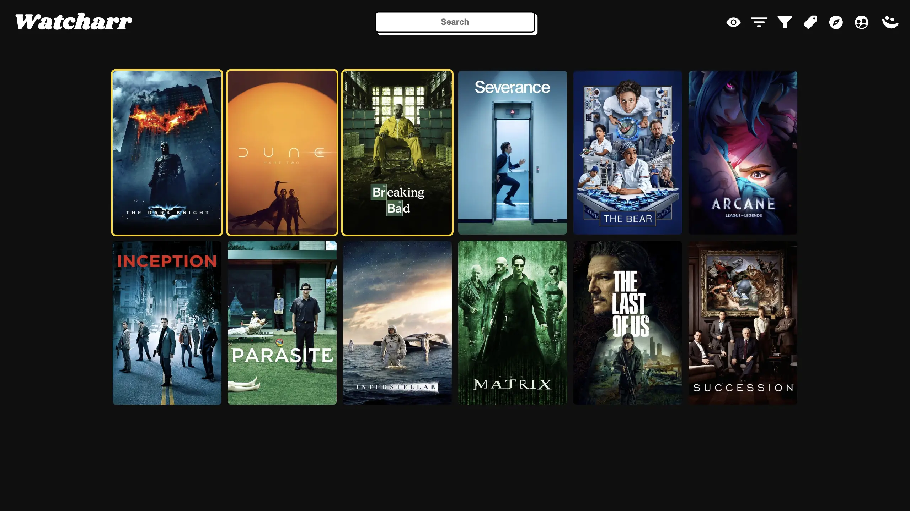

# Deploy and Host Watcharr on Sealos

Watcharr is a self-hosted media tracker for movies, TV shows, anime, and games, with watchlists, ratings, progress tracking, and custom tags. This Sealos template runs Watcharr 4.4.0 as a single StatefulSet with an embedded SQLite database and a persistent 1Gi data volume.

## About Hosting Watcharr

Watcharr runs as one StatefulSet with a single container. The Go server listens on port `3080` and serves the SvelteKit web UI from the same process. SQLite stores users, content metadata, watched entries, ratings, tags, and activity, so the deployment needs no separate database service.

The template mounts a 1Gi volume at `/data`. The volume holds `watcharr.db` with its WAL files, `watcharr.json` with the generated `JWT_SECRET` and server settings, `watcharr.log`, and the `/data/img` poster cache. Keeping this volume preserves accounts, lists, tags, and sessions across Pod restarts and template updates.

The first visitor completes the setup form at `/setup` and becomes the administrator. Later visits use `/login`, and additional users can register when signup stays enabled in Server Settings. The tested profile uses `50m` CPU and `102Mi` memory as requests and `500m` CPU and `1024Mi` memory as limits.

## Common Use Cases

- **Personal Watch Journal**: Record finished, watching, planned, on-hold, and dropped titles with ratings and notes.
- **Household Media List**: Share one instance across family members, each with a private profile and personal list.
- **Anime and TV Tracking**: Follow series progress by season and episode, with status automation for new episodes.
- **Curated Collections**: Group titles with color-coded tags such as genre, mood, or a movie-night shortlist.
- **Library Migration**: Import an existing history from a Watcharr export, TMDb, Trakt, IMDb, or Movary file.
- **Private Self-Hosting**: Keep viewing history and personal notes on infrastructure you control.

## Dependencies for Hosting Watcharr

- A Sealos workspace with at least 1Gi of memory and 1Gi of persistent storage.
- Server-side HTTPS access to `api.themoviedb.org` for search, metadata, and Discover results.
- Server-side HTTPS access to `image.tmdb.org` for poster downloads into the local cache.
- A browser for the setup form, dashboard, search, and settings.
- Optional IGDB and Twitch credentials for video game tracking.
- Optional Jellyfin or Plex connection details for media-server integrations.

### Deployment Dependencies

- [Watcharr project page](https://github.com/sbondCo/Watcharr) - Source code, releases, and issue tracker
- [Watcharr documentation](https://watcharr.app/docs/introduction) - Installation, configuration, and usage guides
- [Docker Compose guide](https://watcharr.app/docs/installation/docker-compose) - Official single-container setup
- [Example compose file](https://github.com/sbondCo/Watcharr/blob/v4.4.0/docker-compose.yml) - Reference image, port, and volume
- [Release v4.4.0](https://github.com/sbondCo/Watcharr/releases/tag/v4.4.0) - Version used by this template
- [Container image](https://github.com/sbondCo/Watcharr/pkgs/container/watcharr) - Multi-architecture image used by this template
- [Environment variables](https://github.com/sbondCo/Watcharr/blob/v4.4.0/doc/docs/server_config/environment-variables.md) - `WATCHARR_DATA` and `PORT`
- [TMDB API documentation](https://developer.themoviedb.org/docs/getting-started) - Metadata and image services used by Watcharr
- [Sealos documentation](https://sealos.io/docs) - Platform concepts and operations

## Implementation Details

**Architecture Components:**

- **Watcharr StatefulSet**: One replica running the Go server and SvelteKit UI on port `3080`.
- **Application volume**: A 1Gi volume at `/data` for SQLite, configuration, logs, and cached posters.
- **Service**: ClusterIP port `80` forwarding to the Watcharr HTTP port.
- **Ingress**: Sealos-managed HTTPS host with a 32Mi request body limit and 300-second proxy timeouts.
- **App entry**: Opens the Watcharr watched list; unauthenticated visitors are redirected to setup or login.

**Configuration:**

- **Image**: `ghcr.io/sbondco/watcharr:v4.4.0`
- **HTTP port**: `3080`
- **Data path**: `/data`
- **Database**: SQLite at `/data/watcharr.db`
- **Server configuration**: `/data/watcharr.json`, including the generated `JWT_SECRET`
- **Poster cache**: `/data/img`
- **Health check**: `GET /`
- **Setup page**: `/setup` for the first user, who becomes administrator
- **Sign-in page**: `/login`
- **Environment variables**: `WATCHARR_DATA=/data`, `PORT=3080`, `TZ=Asia/Shanghai`
- **TMDB key**: Built-in shared key by default; a personal key can be saved in Server Settings
- **Public URL**: `https://${{ defaults.app_host }}.${{ SEALOS_CLOUD_DOMAIN }}/`
- **Security context**: Runs as UID `1000` and GID `1000`, drops all Linux capabilities, disables privilege escalation, and applies the `RuntimeDefault` seccomp profile

**Resource Allocation:**

| Component | CPU Request | CPU Limit | Memory Request | Memory Limit | Storage |
| --- | ---: | ---: | ---: | ---: | ---: |
| Watcharr | 50m | 500m | 102Mi | 1024Mi | 1Gi |

The values above are the live-tested profile. The Pod reached Ready with zero restarts, the setup form created the administrator account, and the tags and session survived a Pod restart. Observed memory ranged from about 33Mi to 95Mi, and CPU use stayed near 4m or lower. TMDB-backed search and poster downloads depend on outbound access from the cluster.

## Why Deploy Watcharr on Sealos?

Sealos is an AI-assisted cloud operating system built on Kubernetes. It provides the compute, storage, networking, and operations layer for Watcharr in one interface:

- **One-Click Deployment**: Create the StatefulSet, volume, Service, Ingress, and App entry from a single template.
- **Embedded Database**: Run the complete application with SQLite, without a separate database cluster.
- **Automatic HTTPS**: Receive a managed public domain and TLS certificate for the web UI.
- **Persistent Watch History**: Keep accounts, lists, ratings, tags, and cached posters on a dedicated volume.
- **Resource Control**: Adjust CPU and memory from the resource card as the library and user count grow.
- **Operational Visibility**: Inspect Pods, logs, events, and resource usage from Canvas or the Sealos AI dialog.

## Deployment Guide

1. Open the [Watcharr template](https://sealos.io/products/app-store/watcharr) and click **Deploy Now**.
2. Confirm the generated application name and submit the deployment.
3. Wait 2-3 minutes for the Pod to become ready and for the HTTPS certificate to be issued.
4. Open the App card. The first visit redirects to `/setup`.
5. Choose an administrator username and password, then click **Set Up**. The first account receives administrator permissions.
6. Search for a movie or TV show, open its result, and add it to the watched list with a status and rating.
7. Open **Server Settings** to configure signup, TMDB, Jellyfin, Plex, or IGDB integrations.

## Using Watcharr

The top bar provides search, watched-list filters, Discover, tags, and the profile menu. Watched entries support the statuses **Finished**, **Watching**, **Planned**, **On Hold**, and **Dropped**, along with a 0-10 rating, personal thoughts, and a pin control.

Tags are color-coded labels created from the tag menu. A tag can hold any number of watched entries and works as a custom list for genres, moods, or shared viewing plans. The profile page exposes statistics, the public list link, import and export actions, and account settings.

Server Settings holds signup control, the default country, a personal TMDB API key, Jellyfin and Plex hosts, Twitch credentials for IGDB game support, and task schedule controls. The optional integrations stay disabled until their credentials are supplied; the core movie and TV tracker works with TMDB access alone.

## Data and Persistence

All state lives on the `/data` volume. SQLite runs in WAL mode and writes `watcharr.db`, `watcharr.db-wal`, and `watcharr.db-shm`; the server writes `watcharr.json` with the JWT secret and server settings, and caches poster files under `/data/img`.

Keep the volume bound for the lifetime of the deployment. Deleting the Instance removes the StatefulSet, Service, Ingress, and PVC, along with every account and watch record. For a manual backup, copy the complete `/data` directory while the Pod is stopped, or use the Watcharr export from the profile page for a portable per-user backup.

## Scaling

Watcharr uses a single SQLite writer, so the template runs one replica. Scale vertically by raising the memory limit for large libraries and busy multi-user instances; poster caching and SQLite page cache both benefit from additional memory.

Horizontal scaling requires an external database, which Watcharr 4.4.0 does not support. Keep the replica count at one and use the 1Gi volume for small and medium libraries. A library with tens of thousands of cached posters can outgrow the volume; plan a larger volume for very large libraries.

## Troubleshooting

### The setup page redirects to login

Watcharr creates the administrator from the first account only. Once a user exists, `/setup` redirects to `/login`. Use the existing credentials, or follow the [restoring admin privileges guide](https://watcharr.app/docs/server_config/restoring-admin) when the administrator password is lost.

### Search fails with `request failed with 400` or `signal timed out`

Watcharr performs TMDB requests from the Pod. Confirm that the cluster can reach `https://api.themoviedb.org` over HTTPS. A personal TMDB API key can be saved under **Server Settings → TMDB Key**; the network path still needs to allow the request.

### Posters stay blank while titles render

Poster files are downloaded by the server from `image.tmdb.org` into `/data/img`. When that host is unreachable, titles and metadata still render and the images stay empty. Restore outbound access and reload the page; Watcharr retries the download for uncached posters.

### The Pod cannot write to `/data`

The container runs as UID `1000` and GID `1000`, and the volume uses `fsGroup: 1000`. Check that the PVC is `Bound` and that the storage class supports the requested access mode. A permission error in the log points to a volume created with an incompatible ownership policy.

### The first user is not an administrator

The first registered account receives the administrator permission. If an earlier account exists, sign in with that account or use the restoring admin guide. Deleting `watcharr.db` resets the instance and removes all data.

### Games do not appear in search

Game tracking uses IGDB through Twitch application credentials. Add the client ID and secret under **Server Settings → Twitch**, then restart the Pod. Movie and TV tracking work without Twitch.

### Sessions expire after a redeploy

The JWT signing secret lives in `/data/watcharr.json`. Replacing the volume generates a new secret, which invalidates existing browser sessions. Keep the same PVC across template updates and restart the Pod after changing server settings.

### The Pod uses more memory than expected

SQLite, the Go runtime, and the poster cache share the container limit. Large libraries and many concurrent users increase memory use. Raise the memory limit from the resource card, and keep the library and image cache within the 1Gi volume.

### Getting Help

- [Watcharr documentation](https://watcharr.app/docs/introduction)
- [Watcharr GitHub issues](https://github.com/sbondCo/Watcharr/issues)
- [Watcharr Matrix room](https://matrix.to/#/#watcharr:matrix.org)
- [Sealos documentation](https://sealos.io/docs)

## License

Watcharr is released under the [GNU General Public License v3.0](https://github.com/sbondCo/Watcharr/blob/v4.4.0/LICENSE). This template is an independent deployment definition and is not affiliated with or endorsed by the Watcharr project. This Sealos template is distributed under the templates repository license.
