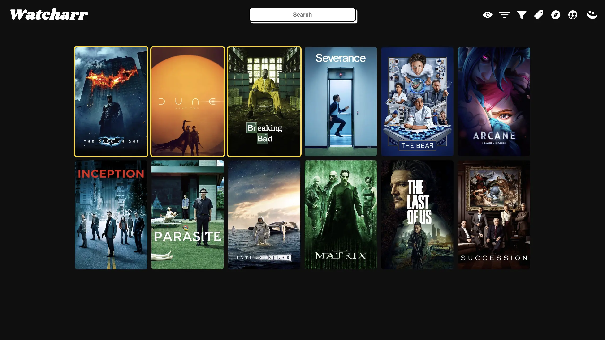

# 在 Sealos 上部署和托管 Watcharr

Watcharr 是自托管的影视与游戏追踪应用，支持观看列表、评分、进度管理和自定义标签。本 Sealos 模板以单个 StatefulSet 运行 Watcharr 4.4.0，内置 SQLite 数据库，并使用 1Gi 持久化数据卷。

## 托管说明

Watcharr 以单个 StatefulSet 运行一个容器。Go 服务监听 `3080` 端口，并在同一进程中提供 SvelteKit Web UI。SQLite 保存用户、内容元数据、观看记录、评分、标签和动态，因此部署无需单独的数据库服务。

模板将 1Gi 卷挂载到 `/data`。该卷保存 `watcharr.db` 及其 WAL 文件、包含自动生成 `JWT_SECRET` 和服务端设置的 `watcharr.json`、`watcharr.log`，以及 `/data/img` 海报缓存。保留该卷可在 Pod 重启和模板升级后继续使用账号、列表、标签和会话。

首位访问者在 `/setup` 完成设置表单并成为管理员。后续访问使用 `/login`，Server Settings 保持开启注册时，其他用户可以自行注册。实测配置以 `50m` CPU 和 `102Mi` 内存作为请求，以 `500m` CPU 和 `1024Mi` 内存作为上限。

## 常见使用场景

- **个人观影记录**：记录已看、在看、计划、搁置和弃看的影片，并附上评分与笔记。
- **家庭媒体清单**：一个实例供家庭成员共用，每人拥有独立资料和观看列表。
- **剧集与动画追踪**：按季和按集记录进度，并通过状态自动化跟进新剧集。
- **主题合集**：用带颜色的标签整理类型、心情或电影之夜片单。
- **媒体库迁移**：从 Watcharr 导出文件、TMDb、Trakt、IMDb 或 Movary 文件导入既有记录。
- **私有自托管**：把观看历史和私人笔记保存在自己掌控的基础设施中。

## 部署依赖

- 至少 1Gi 内存和 1Gi 持久化存储的 Sealos 工作区。
- 集群到 `api.themoviedb.org` 的出网 HTTPS 访问，用于搜索、元数据和 Discover 结果。
- 集群到 `image.tmdb.org` 的出网 HTTPS 访问，用于下载海报到本地缓存。
- 用于设置表单、仪表盘、搜索和设置页面的浏览器。
- 可选的 IGDB 与 Twitch 凭据，用于游戏追踪。
- 可选的 Jellyfin 或 Plex 连接信息，用于媒体服务器集成。

### 部署相关链接

- [Watcharr 项目页](https://github.com/sbondCo/Watcharr)：源码、发布和问题跟踪
- [Watcharr 文档](https://watcharr.app/docs/introduction)：安装、配置和使用指南
- [Docker Compose 指南](https://watcharr.app/docs/installation/docker-compose)：官方单容器部署步骤
- [示例 compose 文件](https://github.com/sbondCo/Watcharr/blob/v4.4.0/docker-compose.yml)：镜像、端口和卷参考
- [v4.4.0 发布](https://github.com/sbondCo/Watcharr/releases/tag/v4.4.0)：本模板使用的版本
- [容器镜像](https://github.com/sbondCo/Watcharr/pkgs/container/watcharr)：本模板使用的多架构镜像
- [环境变量](https://github.com/sbondCo/Watcharr/blob/v4.4.0/doc/docs/server_config/environment-variables.md)：`WATCHARR_DATA` 和 `PORT`
- [TMDB API 文档](https://developer.themoviedb.org/docs/getting-started)：Watcharr 使用的元数据与图片服务
- [Sealos 文档](https://sealos.io/docs)：平台概念与操作

## 实现细节

**架构组件：**

- **Watcharr StatefulSet**：单副本运行 Go 服务与 SvelteKit UI，HTTP 端口 `3080`。
- **应用卷**：挂载到 `/data` 的 1Gi 卷，保存 SQLite、配置、日志和海报缓存。
- **Service**：ClusterIP 端口 `80` 转发到 Watcharr HTTP 端口。
- **Ingress**：Sealos 管理的 HTTPS 域名，请求体上限 32Mi，代理超时 300 秒。
- **App 入口**：打开 Watcharr 观看列表；未认证访问会跳转到设置页或登录页。

**配置：**

- **镜像**：`ghcr.io/sbondco/watcharr:v4.4.0`
- **HTTP 端口**：`3080`
- **数据路径**：`/data`
- **数据库**：SQLite，路径 `/data/watcharr.db`
- **服务端配置**：`/data/watcharr.json`，包含自动生成的 `JWT_SECRET`
- **海报缓存**：`/data/img`
- **健康检查**：`GET /`
- **设置页面**：`/setup`，首位用户在此创建并成为管理员
- **登录页面**：`/login`
- **环境变量**：`WATCHARR_DATA=/data`、`PORT=3080`、`TZ=Asia/Shanghai`
- **TMDB 密钥**：默认使用内置共享密钥，也可在 Server Settings 保存个人密钥
- **公网地址**：`https://${{ defaults.app_host }}.${{ SEALOS_CLOUD_DOMAIN }}/`
- **安全上下文**：以 UID `1000` 和 GID `1000` 运行，丢弃全部 Linux capability，禁用权限提升，并应用 `RuntimeDefault` seccomp 配置

**资源分配：**

| 组件 | CPU 请求 | CPU 上限 | 内存请求 | 内存上限 | 存储 |
| --- | ---: | ---: | ---: | ---: | ---: |
| Watcharr | 50m | 500m | 102Mi | 1024Mi | 1Gi |

以上为实测配置。Pod 达到 Ready 且零重启，设置表单成功创建管理员账号，标签与会话在 Pod 重启后仍然保留。观测内存约 33Mi 至 95Mi，CPU 使用保持在 4m 左右或更低。TMDB 搜索与海报下载依赖集群的出网访问。

## 为什么在 Sealos 上部署 Watcharr？

Sealos 是基于 Kubernetes 的 AI 辅助云操作系统，在一个界面中提供 Watcharr 所需的计算、存储、网络和运维能力：

- **一键部署**：通过单个模板创建 StatefulSet、数据卷、Service、Ingress 和 App 入口。
- **内置数据库**：应用随 SQLite 一起运行，无需额外的数据库集群。
- **自动 HTTPS**：获得托管的公网域名和 Web UI 的 TLS 证书。
- **持久化观影数据**：账号、列表、评分、标签和海报缓存保存在独立数据卷中。
- **资源控制**：在资源卡片中调整 CPU 和内存，适配媒体库与用户规模的增长。
- **运维可视性**：通过 Canvas 或 Sealos AI 对话框查看 Pod、日志、事件和资源使用情况。

## 部署指南

1. 打开 [Watcharr 模板](https://sealos.io/products/app-store/watcharr) 并点击 **Deploy Now**。
2. 确认自动生成的应用名称并提交部署。
3. 等待 2-3 分钟，直到 Pod 就绪并完成 HTTPS 证书签发。
4. 打开 App 卡片，首次访问会跳转到 `/setup`。
5. 设置管理员用户名和密码，点击 **Set Up**。首个账号自动获得管理员权限。
6. 搜索电影或剧集，打开结果并添加到观看列表，设置状态与评分。
7. 打开 **Server Settings**，配置注册、TMDB、Jellyfin、Plex 或 IGDB 集成。

## 使用 Watcharr

顶部栏提供搜索、观看列表筛选、Discover、标签和资料菜单。观看条目支持 **已看（Finished）**、**在看（Watching）**、**计划（Planned）**、**搁置（On Hold）** 和 **弃看（Dropped）** 五种状态，并可填写 0-10 评分、个人笔记和置顶标记。

标签是从标签菜单创建的颜色标识。一个标签可以关联任意数量的观看条目，适合作为类型、心情或共享片单的自定义列表。资料页展示统计信息、公开列表链接、导入导出操作和账号设置。

Server Settings 包含注册开关、默认国家、个人 TMDB API 密钥、Jellyfin 与 Plex 地址、用于 IGDB 游戏支持的 Twitch 凭据，以及任务计划配置。可选集成在填入凭据前保持关闭；影视追踪的核心功能只需 TMDB 访问。

## 数据与持久化

所有状态保存在 `/data` 卷。SQLite 以 WAL 模式运行，写入 `watcharr.db`、`watcharr.db-wal` 和 `watcharr.db-shm`；服务端写入包含 JWT 密钥和服务设置的 `watcharr.json`，并将海报文件缓存到 `/data/img`。

部署生命周期内应保持该卷绑定。删除 Instance 会同时移除 StatefulSet、Service、Ingress 和 PVC，并清除全部账号与观看记录。手动备份可在 Pod 停止后复制完整的 `/data` 目录，也可使用资料页的 Watcharr 导出功能生成单用户便携备份。

## 扩展

Watcharr 使用单写入 SQLite，因此模板运行单副本。媒体库较大或多人同时使用时，可提高内存上限；海报缓存和 SQLite 页缓存都会受益于更多内存。

横向扩展需要外部数据库，Watcharr 4.4.0 使用 SQLite 存储。副本数保持为 1，1Gi 卷可满足中小型媒体库。缓存了数万张海报的媒体库可能超出卷容量，超大媒体库应规划更大的数据卷。

## 故障排查

### 设置页跳转到登录页

Watcharr 仅通过首个账号创建管理员。已有用户后，`/setup` 会跳转到 `/login`。使用现有凭据登录；管理员密码丢失时，按[恢复管理员权限指南](https://watcharr.app/docs/server_config/restoring-admin)操作。

### 搜索返回 `request failed with 400` 或 `signal timed out`

Watcharr 从 Pod 内发起 TMDB 请求。确认集群可通过 HTTPS 访问 `https://api.themoviedb.org`。个人 TMDB API 密钥可在 **Server Settings → TMDB Key** 中保存，网络路径仍需允许该请求。

### 标题正常显示但海报空白

海报由服务端从 `image.tmdb.org` 下载到 `/data/img`。该域名不可达时，标题和元数据仍可显示，图片保持空白。恢复出网访问后刷新页面，Watcharr 会重新下载未缓存的海报。

### Pod 无法写入 `/data`

容器以 UID `1000` 和 GID `1000` 运行，数据卷使用 `fsGroup: 1000`。确认 PVC 状态为 `Bound`，且存储类支持请求的访问模式。日志中的权限错误通常来自卷的属主策略不兼容。

### 首个用户没有管理员权限

首个注册账号会获得管理员权限。若此前已存在账号，使用该账号登录，或按恢复管理员指南操作。删除 `watcharr.db` 会重置实例并清除全部数据。

### 搜索中没有游戏

游戏追踪通过 Twitch 应用凭据使用 IGDB。在 **Server Settings → Twitch** 填入客户端 ID 和密钥，然后重启 Pod。电影和剧集追踪无需 Twitch。

### 重新部署后会话失效

JWT 签名密钥保存在 `/data/watcharr.json`。更换数据卷会生成新密钥，使现有浏览器会话失效。模板升级时保留同一个 PVC，并在修改服务端设置后重启 Pod。

### Pod 内存占用高于预期

SQLite、Go 运行时和海报缓存共享容器内存上限。媒体库变大和并发用户增多都会提高内存占用。可在资源卡片中提高内存上限，并将媒体库与图片缓存控制在 1Gi 卷范围内。

### 获取帮助

- [Watcharr 文档](https://watcharr.app/docs/introduction)
- [Watcharr GitHub Issues](https://github.com/sbondCo/Watcharr/issues)
- [Watcharr Matrix 房间](https://matrix.to/#/#watcharr:matrix.org)
- [Sealos 文档](https://sealos.io/docs)

## 许可证

Watcharr 采用 [GNU General Public License v3.0](https://github.com/sbondCo/Watcharr/blob/v4.4.0/LICENSE)。本模板是独立部署定义，与 Watcharr 项目无隶属或背书关系。本 Sealos 模板遵循 templates 仓库许可证。
